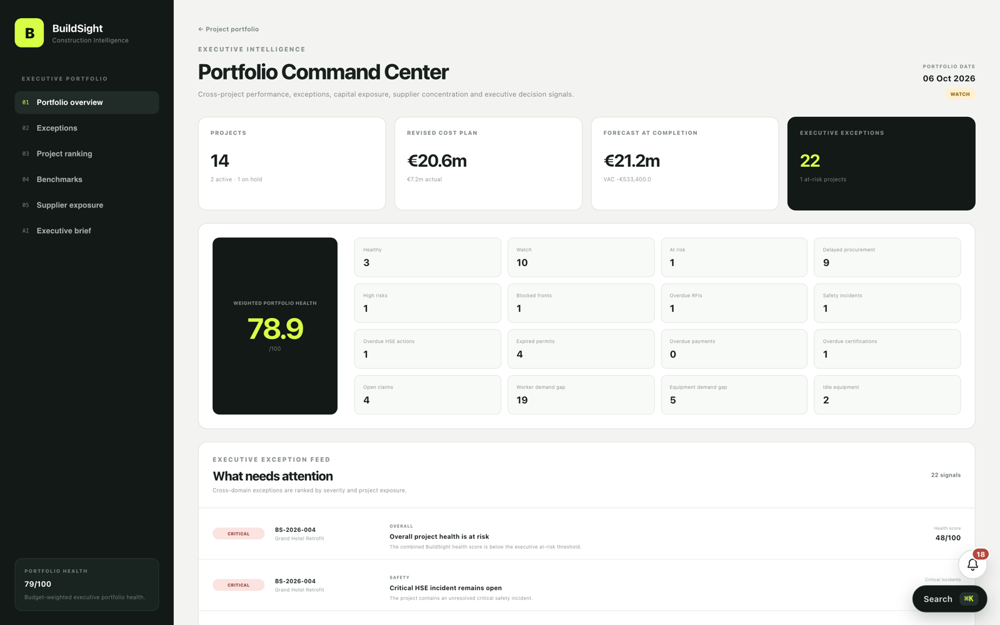
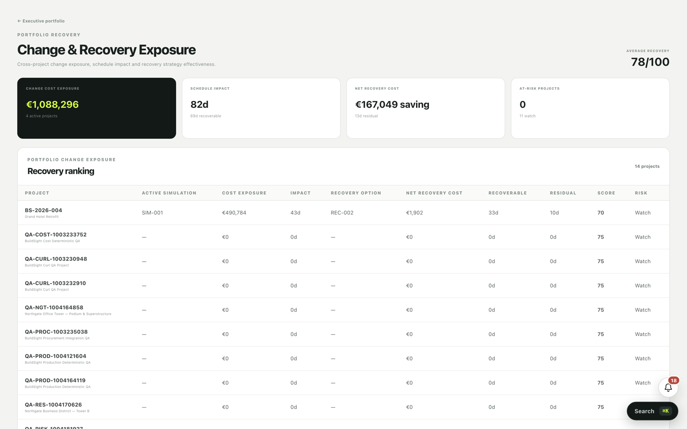
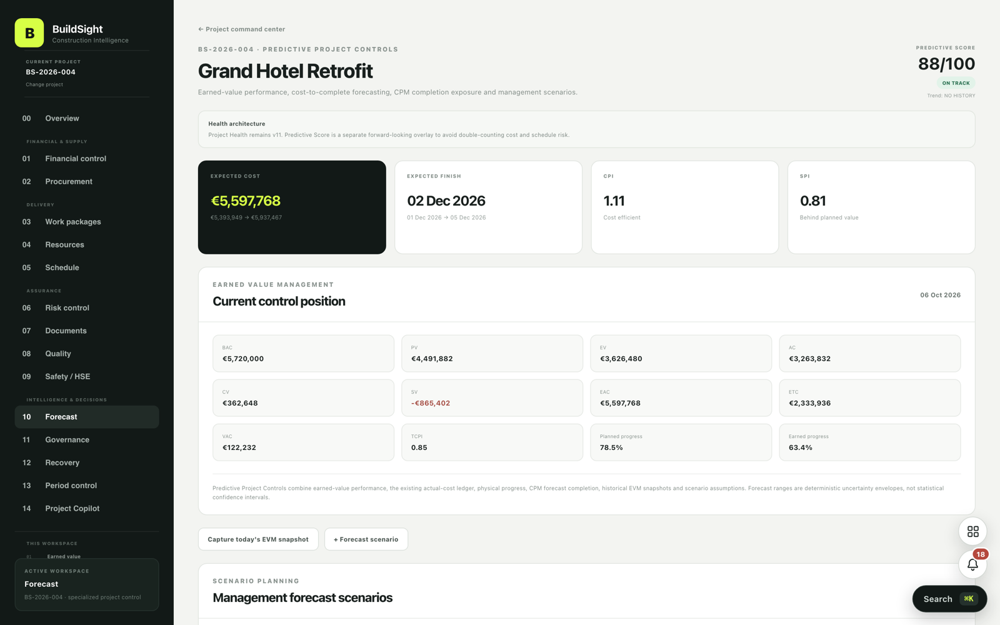
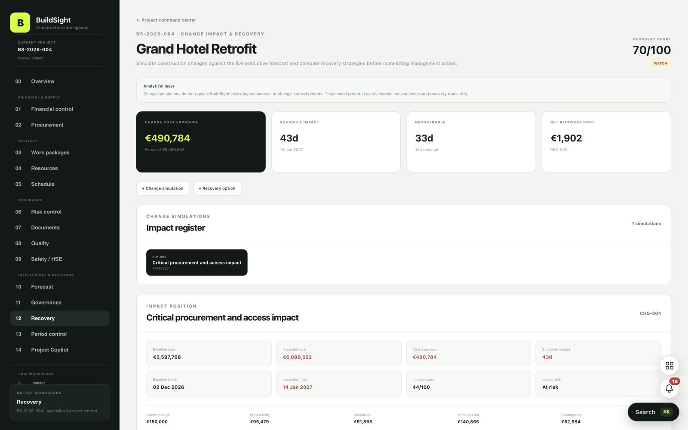
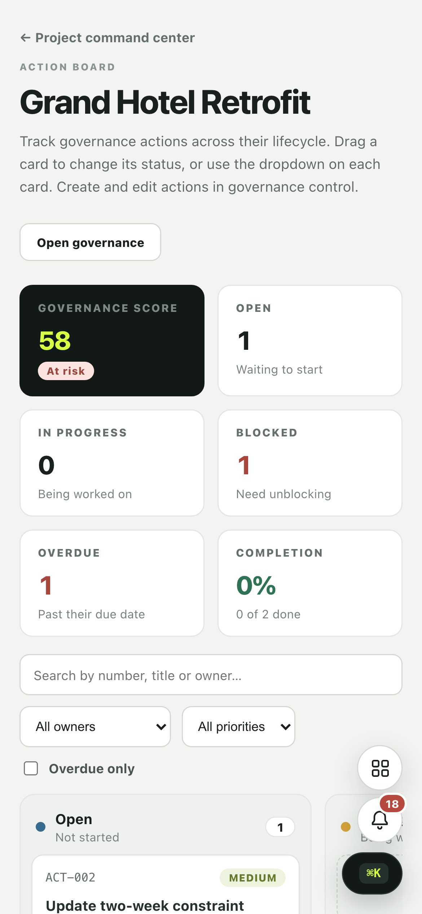
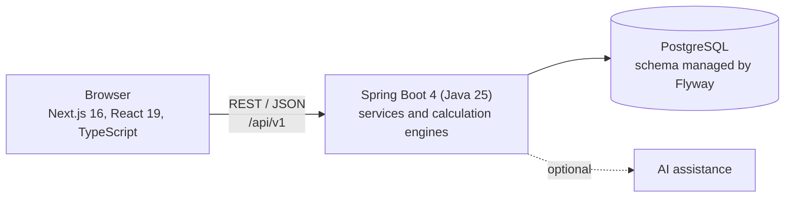

# BuildSight

**A project-controls platform for construction. It tells a site team which projects are slipping, why, and what recovering them would cost, in plain-language answers instead of dashboards full of numbers.**



<!-- TODO: add the live demo link and the demo video link on this line, for example: [Live demo](URL) · [Demo video](URL) -->

## Why it exists

Construction managers juggle schedule, cost, risk, safety, quality and paperwork across several sites, usually in separate spreadsheets that disagree with each other. BuildSight puts them in one place and answers the questions a site manager actually asks:

- *Is the cash arriving when we need it?*
- *How sure is the finish date?*
- *What if this activity slips?*
- *Do the payment certificates add up?*
- *Can the risk register be trusted?*

Most feature pages are titled with the question they answer and open with a short explanation of how to read them.

## Screenshots

| Portfolio recovery plan | Project forecast |
| --- | --- |
|  |  |

| Recovery options | Action board on a phone |
| --- | --- |
|  |  |

## What it does

More than 80 focused pages (126 routes in total), grouped by area. Each is named after its question.

**Portfolio**
Control tower across every project ("Every project, every lens"), portfolio forecast, recovery plan, governance, period control, comparison, executive report and a one-file export of every project.

**Schedule and forecast**
Are we where the schedule says we should be (progress curve) · How sure is the finish date (finish simulation) · What if this activity slips (slip explorer) · When does the schedule run out of room (pinch points) · How does the work connect (logic map) · Is the forecast settling down (forecast drift) · Can the schedule be trusted · Can the next activities actually start · Lookahead board · Will each work package finish on time at its current pace (run rate) · How far have the baselines moved.

**Recovery and change**
Recovery options with cost, days recovered and a **net recovery cost** (a negative figure is a net saving), a recovery board, scenario board and a change-impact simulation engine.

**Cost and commercial**
Is the cash arriving when we need it · How far has the budget moved from the original plan · How much of what we ask for is valued, and how much is agreed · What the project is owed · Do the payment certificates add up · How long do decisions and payments take.

**Procurement and suppliers**
Procurement pipeline, supplier board, and "Did the packages go to the lowest bid, and when not, why?"

**Production and resources**
Which work packages are burning through their labour hours · Do the crews we deploy match the hours the site reports record · Does the equipment log match the plant hours · What are idle and broken-down machines costing us · Which trades are on site, week by week · Are the crews on site as big as the plan · Resource heatmap · Weekly work sheet for each trade.

**Quality, safety and permits**
Were closed NCRs closed properly · Which inspections are due, and which have slipped · Do inspections pass first time · How often are people getting hurt, for the hours we work · Does every hazard get a corrective action · Are incidents reported promptly and investigated properly · Which crews are working too long without a break · Are work permits run and closed properly · Which permitted jobs are about to land on top of each other · How many working days has the weather really cost us.

**Risk**
Can the risk register be trusted · Which registered risks turned into real problems · Where does trouble keep turning up · What causes most of the problems (Pareto) · Risk board and matrix.

**Governance and reporting**
Meeting pack with the agenda already filled in · Are the project meetings still happening as often as they should · Do the meetings produce decisions and actions that get done · What has changed since the last report · What is happening on site today (site brief) · Who delivers on time (owner reliability).

**Documents and handover**
Is the paperwork under control · RFI and document board · Have the revisions we issued actually been sent to anyone (transmittal coverage) · Are handover documents arriving by their due dates · How close is handover.

**Everyday tools**
What needs doing next (inbox) · Find anything in this project · Everything in this project (map) · Every deadline in one calendar · What has been happening (activity) · What am I keeping an eye on (watchlist) · Action board with drag and drop and screen-reader labels · Is the project data fit to trust (data health) · Take the data with you (export).

**Optional AI assistance**
Project brief, portfolio brief and an ask-the-project assistant, with a status endpoint that reports whether they are available.

## Design decisions

- **Questions, not dashboards.** A page that answers one question is easier to trust and easier to act on than a wall of charts.
- **Can the data be trusted?** A whole family of pages reconciles one record against another (payment certificates, daily production against package totals, deployed crews against reported hours, equipment logs against plant hours, the risk register against what happened). Bad inputs are shown, not hidden.
- **Honest numbers.** Recovery cost is the cost of an option minus the time-related savings from the days it recovers, so it can be negative; the UI says "net saving" rather than showing a bare minus sign. Runaway percentages show as ">999%" and backend codes such as `AT_RISK` become readable labels. The audit below fails any page that shows `NaN`, `Infinity` or an empty 1970 date.
- **Works on a phone.** Site managers read this standing on site. Pages are checked at 390 px wide.

## Architecture



## Tech stack

| Layer | Technology |
| --- | --- |
| Backend | Java 25, Spring Boot 4.1, Maven wrapper, REST API under `/api/v1` |
| Database | PostgreSQL, Flyway migrations, started with Docker Compose |
| Frontend | Next.js 16 (App Router), React 19, TypeScript, CSS Modules |
| Quality | Playwright browser audit of every route, TypeScript type check |

## Getting started

You need Java 25, Node.js 20.9 or newer, and Docker.

```bash
git clone <your-repository-url>
cd buildsight
docker compose up -d
```

Start the backend (it listens on port 8080 and allows the frontend's address):

```bash
cd backend
BUILDSIGHT_CORS_ALLOWED_ORIGINS=http://localhost:3000 ./mvnw spring-boot:run
```

Start the frontend in a second terminal:

```bash
cd frontend
npm install
npm run dev
```

Open http://localhost:3000. The API is at http://localhost:8080/api/v1.

<!-- TODO: say how demo data is loaded (seed on first start, or a script), and which AI provider and key the optional AI features need -->

## Quality checks

```bash
cd frontend
npm run typecheck
```

`tools/audit` holds a read-only browser audit. It opens every route in a headless browser at desktop and phone width. A page fails on a script error, a failed backend call, an error banner, `NaN` or `Infinity`, or an empty default date. It warns on a raw backend code shown instead of a label, a percentage in the thousands, or sideways scrolling on a phone. The latest full run opened all 126 routes with no failures.

```bash
cd tools/audit
npm init -y && npm install playwright && npx playwright install chromium
SMOKE_PROJECT_DIR=../../frontend node audit.mjs
```

## Known limitations and next steps

- No login or roles yet; the app assumes a trusted network.
- The audit reads data only. Create, update and approve flows are not covered by automated tests yet.
- Risk and governance thresholds are starting values and should be tuned with site teams.
- Ideas for next: authentication and roles, write-flow tests, and email or chat alerts for the inbox.

## Author

Mahmoud Mansouri
<!-- TODO: add your portfolio and LinkedIn links -->
